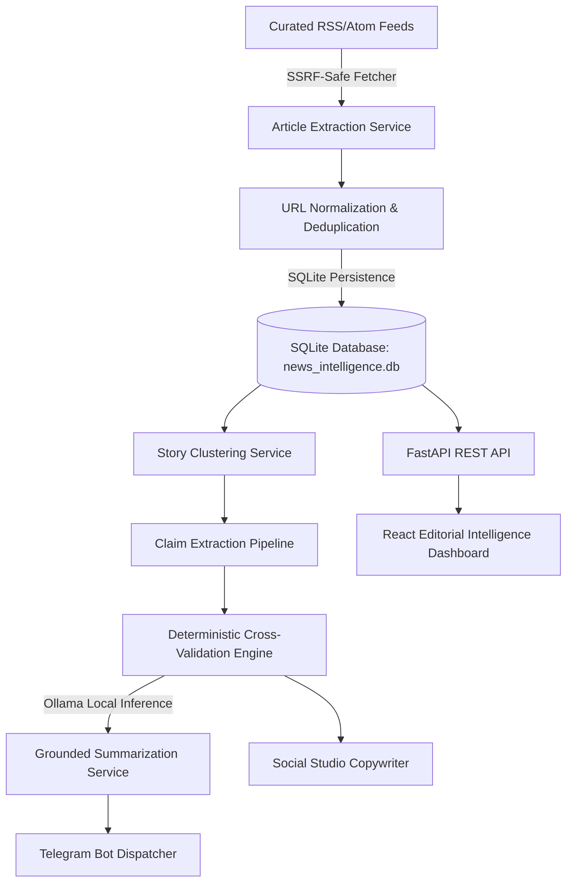

# System Architecture & Technical Specifications

## 1. Overview
The **YGF News Intelligence Agent** is an autonomous, locally operating AI engine built for the YGF NGO evaluation task. Its purpose is to continuously monitor accessible AI and technology RSS news feeds, detect and deduplicate duplicate reporting, cluster related articles into stories, extract concrete factual claims, cross-validate those claims across independent sources through a deterministic rule engine (supported by local Ollama LLMs), produce grounded summaries with traceable source URLs, generate platform-specific social media drafts, and optionally deliver verified news alerts via Telegram.

---

## 2. Core Subsystems

### A. Ingestion & SSRF Security Boundary
- **Target Feeds:** Curated registry of accessible RSS/Atom feeds (Official AI research blogs, tech newsrooms, ArXiv CS.AI).
- **SSRF Guard:** The `validate_url_safe` validator inspects all user-configured and default URLs:
  - Blocks loopback (`127.0.0.0/8`, `::1`, `localhost`).
  - Blocks RFC 1918 private IPv4 subnets (`10.0.0.0/8`, `172.16.0.0/12`, `192.168.0.0/16`).
  - Blocks cloud metadata and link-local ranges (`169.254.0.0/16`, `fe80::/10`).
  - Re-evaluates destination IP on HTTP redirects to prevent open-redirect SSRF bypasses.
- **Article Extractor:** Extracts main readable article text using BeautifulSoup, decomposes scripts/styles/ads, and gracefully falls back to RSS description snippets when extraction is blocked.

### B. Normalization & Deduplication
- **Canonical URLs:** Strips tracking/analytics query parameters (`utm_*`, `ref`, `fbclid`, `gclid`), lowercases hostname/scheme, strips standard default ports (`80`, `443`), and cleans trailing slashes.
- **Title Fingerprints:** Strips publisher suffixes (`| TechCrunch`, `- The Verge`, `| VentureBeat`), normalizes whitespace, and generates SHA-256 content hashes.

### C. Story Clustering
- Groups articles reporting on the same underlying event into a cohesive `Story`.
- Computes Jaccard token similarity over meaningful entities and model versions (retaining versions like `4.5` and `o3`).
- Automatically promotes official lab announcements to `primary_article`.

### D. Cross-Validation Engine
The core evaluation engine does not treat LLMs as proof of truth.
1. **Claims Extraction:** Extracts 2–4 concrete, checkable factual claims per story.
2. **Evidence Evaluation:** Compares claims against other articles in the cluster.
3. **Discrepancy Detection:** Identifies conflicting numbers, dates, or benchmark scores.
4. **Source Independence Rule:** Multiple republished copies of the same press release count as one underlying source. Single-source reports are strictly classified as `INSUFFICIENT_EVIDENCE`.
5. **Confidence Score Heuristic:** Explicitly computed heuristic based on evidence coverage (40%), source independence (35%), and consistency (25%).

### E. Local LLM Service (Ollama)
- Communicates with Ollama HTTP API (`http://localhost:11434`).
- Configurable model (default `qwen3:4b` or `qwen2.5:3b`).
- Enforces strict JSON output formatting.
- Prompt injection mitigation: untrusted external article text is encapsulated within explicit `<UNTRUSTED_ARTICLE_EVIDENCE>` boundaries with system prompts instructing the model never to execute embedded instructions.
- Graceful offline fallback: if Ollama is unreachable, collection, clustering, deterministic verification, and storage proceed without interruption.

### F. Social Studio
- Produces platform-tailored drafts:
  - **LinkedIn:** Professional editorial analysis, hook, industry impact, hashtags, source attribution.
  - **X (Twitter):** Strictly enforced $\le 280$ characters, concise takeaway, source link.
  - **Instagram:** Engaging caption, bulleted facts, source attribution, hashtags.
- All drafts are stored in `DRAFT` status and require human editorial approval before external sharing.

### G. Notification Delivery (Telegram)
- Backend-only credential storage.
- Markdown formatting, message chunking, rate limit handling, and duplicate dispatch prevention.
- Graceful disabled state when unconfigured.

---

## 3. Database Schema

| Table | Description |
| :--- | :--- |
| `news_sources` | Feed registry with reliability score, category, and official status |
| `articles` | Ingested articles with canonical URL, content hash, and extracted text |
| `stories` | Clustered news events with verification status and heuristic confidence |
| `story_articles` | Association table linking stories to articles |
| `claims` | Concrete checkable statements extracted from primary reports |
| `evidence` | Cross-source evaluation verdicts (`SUPPORTS`, `CONTRADICTS`, `INSUFFICIENT`) |
| `verification_results`| Audit log of verification evaluations |
| `social_posts` | Platform-specific drafts (`DRAFT`, `APPROVED`) |
| `notification_deliveries` | Telegram delivery log and message IDs |
| `collection_runs` | Ingestion run audit trail with duplicate counts and diagnostics |
| `application_settings` | Dynamic runtime configurations |
